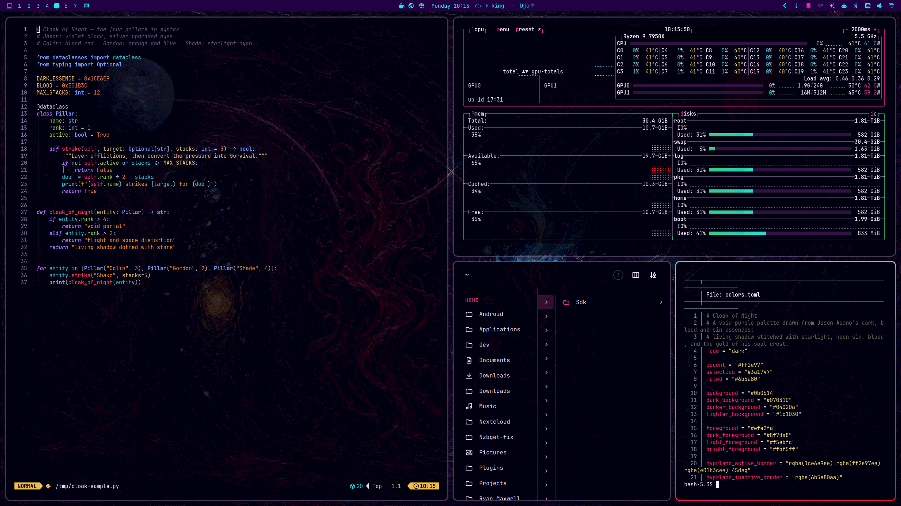
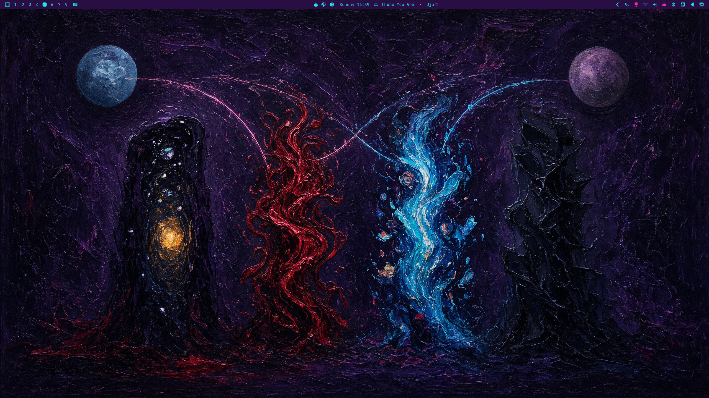
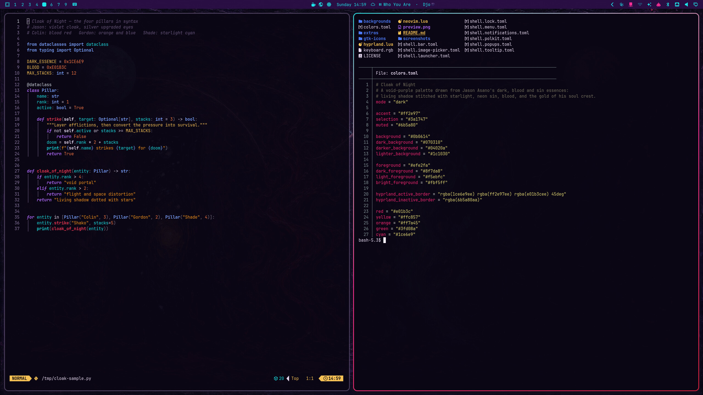
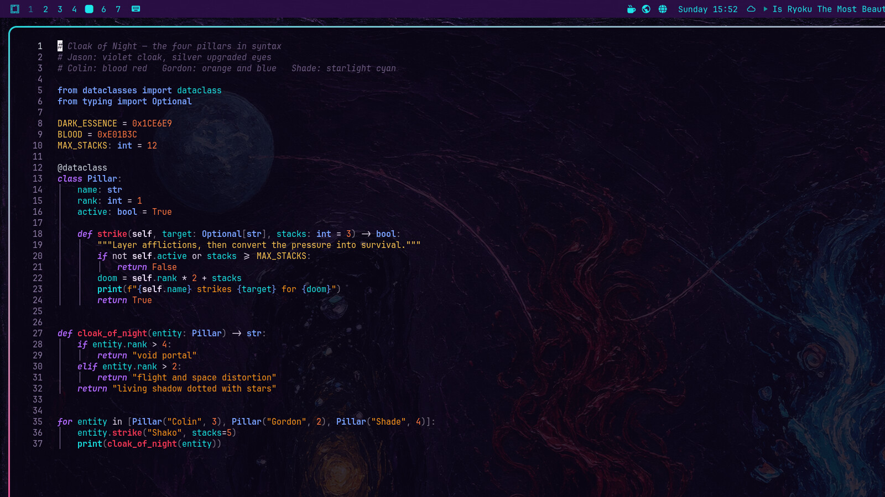

# Cloak of Night

A dark, purple-y [Omarchy](https://omarchy.org) theme drawn from *He Who Fights
with Monsters* by Shirtaloon (Travis Deverell), and from Jason Asano's essences.



A real 2560x1440 desktop session in the same four-window layout as Omarchy's
stock theme previews; this is the image the theme picker shows.

Jason's Cloak of Night is "a voluminous cloak ... more like an object of living
darkness than fabric, dotted with tiny points of light ... tiny stars in the
night sky of the shadowy garb". His soul crest is a floating black cloak on a
sea of dark night with silver stars, holding an open blue sky with a glowing
golden sun. This theme is that cloak as a desktop.

## Colors

| Key | Color | In the books |
| --- | --- | --- |
| `accent`, `magenta` | neon pink | Sin essence; the theatrical, deliberately monstrous Jason |
| `cyan`, `blue` | neon cyan / blue | Midnight Eyes, void portals, orange-and-blue nebular eyes |
| `red` | blood red | Blood essence, Colin the Sanguine Horror, dark red robes |
| `yellow` | gold | The glowing golden sun of his soul crest; gold rank |
| `background` | void purple | The cloak of living darkness and the void it opens into |
| `foreground` | starlight lavender | Silver stars scattered through the cloak |

`purple` / `bright_purple` are true violets, so the terminal's fifth color slot
does not collapse into the pink accent. `ember` is a neon orange for quoted
strings. The `icon_*` keys give the dock's app icons a violet-to-pink gradient
with cyan star marks. Windows carry a 45° cyan → pink → blood-red border
gradient.

## What's in the theme

| File | Purpose |
| --- | --- |
| `colors.toml` | The palette. Omarchy generates the terminals, Neovim, a VS Code / Cursor / VSCodium theme extension, btop, Helix, GTK, Qt, tmux, Obsidian, the shell, the browser policy and more from this one file. |
| `neovim.lua` | Override for `aether.nvim`, mapping syntax to the four pillars (see below). |
| `hyprland.lua` | Soft violet window bloom, 10 px corners and a slow border sweep. |
| `keyboard.rgb` | Void-violet keyboard backlight. |
| `shell.*.toml` | Starlight text and neon accents on the lock screen, launcher, menus, notifications, popups, polkit prompt, tooltips and image picker. |
| `backgrounds/` | Six 16:9 wallpapers at 2560x1440, below. |
| `gtk-icons/` | A small GTK icon theme for blood-red Nautilus folders (see below). |
| `extras/` | Installable copies of the machine-side extras described below. |

Stock themes ship `neovim.lua` and `vscode.json` to point at *published*
colorschemes and extensions that share their name. Cloak of Night has no
published counterpart, so its `neovim.lua` is a full `aether.nvim` spec using
this palette exactly, and no `vscode.json` is needed — the generated VS Code
theme uses the colors directly.

## Install

### Just the theme

```sh
git clone https://github.com/obitheway/cloak-of-night.git \
  ~/.config/omarchy/themes/cloak-of-night
omarchy theme set "Cloak of Night"
```

Or clone anywhere and copy the directory into `~/.config/omarchy/themes/`.
Applying the theme also retints Neovim, the terminals, btop, Helix, the shell,
GTK, Qt, tmux, Obsidian, the browser and the keyboard backlight.

> **Note:** `omarchy theme install <url>` deliberately strips files that run
> code, which here means **`hyprland.lua` and `neovim.lua`**. Clone the repo as
> above if you want the window bloom and the four-pillar Neovim palette. The
> colors, wallpapers, gradients and shell styles survive either way.

### Optional extras from `extras/`

These are separate from Omarchy's theme system and live outside the theme
directory, so they are shipped as ready-to-copy files:

```sh
T=~/.config/omarchy/themes/cloak-of-night

# Blood-red Nautilus folders, re-applied on theme switch
ln -sfn "$T/gtk-icons" ~/.local/share/icons/cloak-of-night
gsettings set org.gnome.desktop.interface icon-theme cloak-of-night
mkdir -p ~/.config/omarchy/hooks/theme-set.d
cp "$T/extras/10-cloak-of-night-folders" ~/.config/omarchy/hooks/theme-set.d/
chmod +x ~/.config/omarchy/hooks/theme-set.d/10-cloak-of-night-folders

# Plain Vim (Neovim is themed automatically)
mkdir -p ~/.vim/colors
cp "$T/extras/vim/colors/omarchy.vim" ~/.vim/colors/
```

Then add to `~/.vimrc`:

```vim
if ($COLORTERM ==# 'truecolor' || $COLORTERM ==# '24bit') && has('termguicolors')
  set termguicolors
endif
syntax on
colorscheme omarchy
```

The Vim colorscheme reads the active theme's `colors.toml` at load time, so it
follows whichever Omarchy theme you switch to. The GTK folder hook does nothing
for other themes, so stock folders return automatically.

## Backgrounds

The first four are astrophotography from [Wallhaven](https://wallhaven.cc); 5
and 6 are original paintings generated for this theme. All are 16:9 at
2560x1440 with metadata stripped. Cycle them with `omarchy theme bg next`.

| | |
|---|---|
| `1-sin-essence.jpg` | A magenta emission streak — Sin |
| `2-nebular-eyes.jpg` | Pink, cyan and blood-red emission — the nebular eyes |
| `3-cloak-of-stars.jpg` | Violet clouds scattered with stars — the cloak |
| `4-blood-essence.jpg` | A red emission nebula — Blood |
| `5-four-pillars.jpg` | The four pillars between Earth and Pallimustus — Dawn's first painting |
| `6-invasion-of-pallimustus.jpg` | Pallimustus encircled by flying citadels — Dawn's warning |

### Dawn's paintings (book 5)

On Earth, Jason visits the gallery run by Susan, Annabeth Tilden's wife, and
buys two paintings by a rising artist named Dawn — actually the
World-Phoenix's vessel, whose art may be magical. Susan sells them on the
condition that Jason can name the subjects of the first.

- The first shows **abstract depictions of Jason and his three familiars —
  Colin the Sanguine Horror, Gordon the Avatar of Doom, and Shade the Shadow
  of the Hegemon — standing between Earth and the other world**. Jason hangs
  them in his cloud houseboat. `5-four-pillars.jpg` renders the four as
  pillars: a star-speckled shadow cloak with a golden sun at its heart, a
  blood-red swarm, a cyan nebula threaded with blue-and-orange butterflies,
  and layered shadow silhouettes, holding blue Earth and violet Pallimustus
  apart.
- The second is titled **"The Invasion of Pallimustus"**, showing the other
  world surrounded by flying cities — a warning of the Builder's coming
  invasion and the monster surge Jason's return will unleash. It is also the
  first time the other world is *named*. `6-invasion-of-pallimustus.jpg`
  shows the violet planet ringed by dark spired sky-citadels, with blood-red
  rifts creeping across its surface.

Both were generated with Grok Imagine Image 2.0 (xAI) and are included here at
2560x1440. They are kept dark so light UI text stays readable.

Wallhaven IDs (backgrounds 1-4): `lq5z8p`, `yxz1kg`, `m3jme8`, `1kdgpg`.

## Neovim

Neovim normally gets a generated `aether.nvim` spec from `colors.toml`. This
theme ships its own `neovim.lua` override so syntax reads as the four pillars:

| Role | Colour | Syntax |
| --- | --- | --- |
| Jason's cloak | violet `#b26bff` | keywords, conditionals, loops, `def`/`class` |
| Jason's upgraded eyes | silver `#d6dde8` | `@attribute`, `@annotation`, `SpecialChar`, line number |
| Colin | blood red `#f23956` | function names, tags |
| Gordon | orange + blue | numbers/booleans, types/statements |
| Gordon's butterflies | neon orange `#FF991C` | quoted strings, characters |
| Shade | starlight cyan | variables, parameters, properties, preproc |
| Soul-crest sun | gold | constants |

The editor background has no fill of its own, so it is transparent wherever
your `~/.config/nvim/plugin/after/transparency.lua` strips backgrounds from
`Normal` and friends. Seeing the wallpaper through it also needs a see-through
terminal: Ghostty, for example, needs `background-opacity = 0.85` and
`background-opacity-cells = true` (the second is required for apps like Neovim
that repaint the background). The void-purple wallpaper then shows through the
editor, which suits the cloak. `neovim.lua` has the palette baked in; if you
change `colors.toml`, regenerate it.

## Folder icons (GTK)

Omarchy themes its own **app icons** — the ones in the dock and launcher —
from `colors.toml`. Nautilus **folder and file icons** are a separate layer:
they come from the GTK icon theme, which Omarchy does not theme (`omarchy icons`
manages app-icon sets only, and `icons.theme` is a legacy file from older
releases).

`gtk-icons/` is a small GTK icon theme that inherits Adwaita and recolors only
its folder artwork to the theme's blood red, keeping the native shapes and
shading. Omarchy app icons still resolve from hicolor, so both layers work
together. `omarchy-theme-set-gnome` resets the GTK icon theme to Adwaita on
*every* theme switch, so the hook in `extras/` re-applies this one when Cloak of
Night is the active theme and does nothing for any other theme.

## Screenshots







## Credits

- Wallpapers 1–4: [Wallhaven](https://wallhaven.cc) photographers (IDs listed above).
- Wallpapers 5–6: Generated with Grok Imagine Image 2.0 (xAI) via OpenCode
  Console. You own the outputs under xAI's terms; attribution is given here.
- Book inspiration: Shirtaloon (Travis Deverell), *He Who Fights with Monsters*.
- Folder artwork: derived from GNOME's Adwaita icon theme.
- Neovim palette: built on [aether.nvim](https://github.com/omacom/aether.nvim).

This theme is fan-made and is not affiliated with or endorsed by the author.
